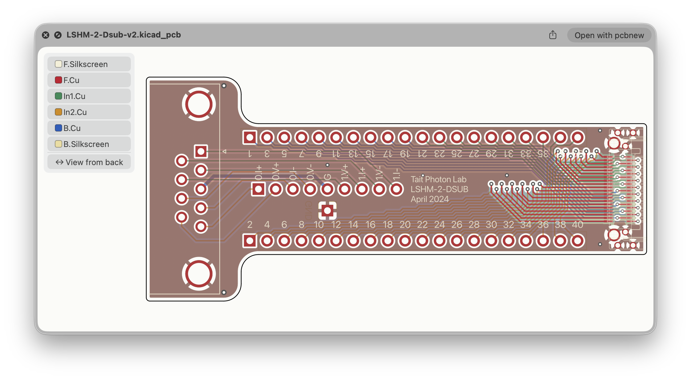
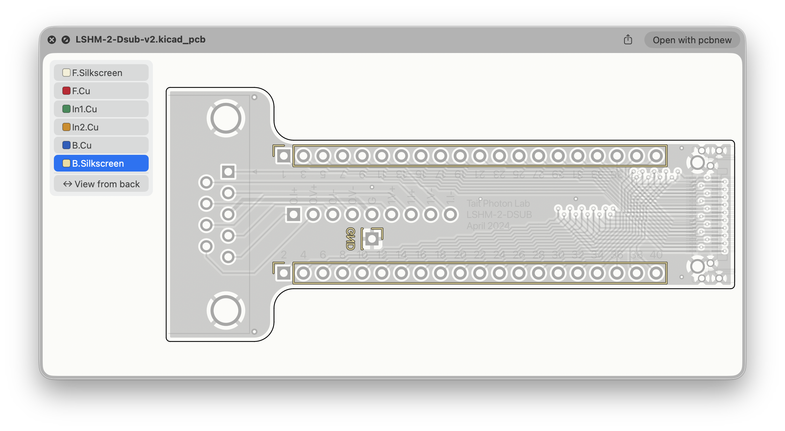

# KiCad QuickLook

Press Space on a KiCad board (`.kicad_pcb`), footprint (`.kicad_mod`) or schematic (`.kicad_sch`) in
Finder to see a preview.
KiCad doesn't need to be installed.



## Using it

- **Zoom**: pinch, or use the mouse wheel.
- **Pan**: scroll with two fingers, or click and drag.
- **Fit to window**: double-tap with two fingers.
- **Open in KiCad**: double-click or Cmd+O.

**Boards:** click a layer in the legend to bring it to the front. Click it again to see all layers.
**View from back** shows the board from the bottom, mirrored.



**Footprints:** shown like a board, without the back view. The legend also has the fab, solder mask
and Edge.Cuts layers, each pad is labelled with its number, and silkscreen is drawn dark.

**Schematics:** the sheet is drawn in KiCad's colours. Zoom in to read small text. For a hierarchical
design, the top sheet shows each sub-sheet as a box. To see what's inside, preview the sub-sheet's own
file.

The preview is an overview, not a replacement for KiCad. It uses the system font rather than KiCad's.

## Install

1. Download `KiCadQL.zip` from the [Releases](../../releases) page and unzip it.
2. Move `KiCadQL.app` to your Applications folder and open it once. You can quit it straight away.
3. If previews don't appear, turn on *KiCad PCB Preview* in System Settings ▸ General ▸ Login Items &
   Extensions ▸ Quick Look.

Requires macOS 14 or later.

## Building from source

See [docs/XCODE.md](docs/XCODE.md). To try the renderer without Xcode:

```sh
swift run -c release --package-path KiCadPCBKit kiql-render examples/LoomRide-v1.kicad_pcb out.png 1200
swift run -c release --package-path KiCadPCBKit kiql-render examples/SkySense-bank.kicad_sch out.png 2000
swift run -c release --package-path KiCadPCBKit kiql-render examples/Crystal_HC49-U-3Pin_Vertical.kicad_mod out.png 1200
swift test --package-path KiCadPCBKit
```
